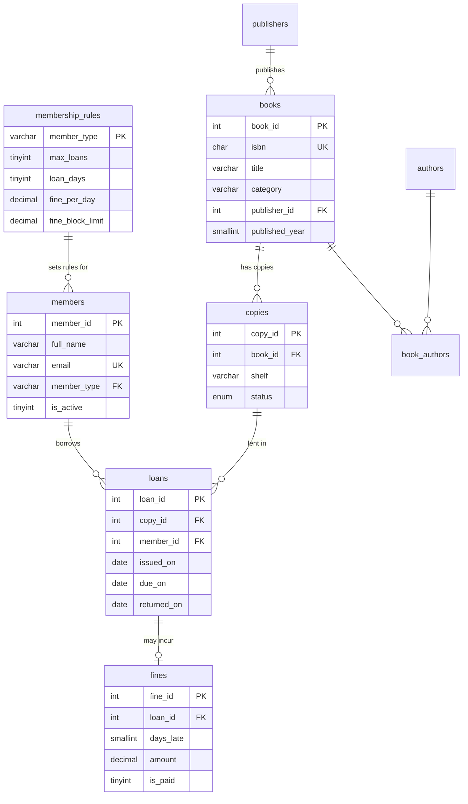

# Library Management Database

A MySQL 8 database for a college library where the business rules live in the database itself:
**stored procedures** lend and return books, **triggers** keep copy status and late fines correct
automatically, **constraints** reject bad data, and **views** answer the librarian's everyday questions.

The repository includes a seed generator that replays **15 months of borrowing history**
(2,236 loans by 300 members across 141 copies of 43 titles) through the stored procedures,
and **15 automated tests** that run on a fresh MySQL 8 server in GitHub Actions on every push.

## Data model

Normalised to third normal form (3NF): each fact is stored once, and every column depends only on
its table's key. Borrowing rules are data, not code, so changing a loan period is an `UPDATE`.



| Member type | Max books | Loan period | Fine per late day | New loans blocked at unpaid fines of |
|---|---:|---:|---:|---:|
| Student | 3 | 14 days | ₹5 | ₹100 |
| Staff | 5 | 30 days | ₹2 | ₹200 |

## How the rules are enforced

| Object | Type | What it does |
|---|---|---|
| `sp_issue_book(member, book, date)` | Procedure | Checks the member exists and is active, is under their borrowing limit and fine limit, then locks and lends the lowest-numbered free copy (`SELECT … FOR UPDATE` inside a transaction, so two librarians can't lend the same copy). Each failure raises a clear error with `SIGNAL`. |
| `sp_return_book(copy, date)` | Procedure | Closes the open loan for a copy, or raises "This copy is not on loan". |
| `sp_pay_fines(member, date)` | Procedure | Marks all of a member's unpaid fines as paid. |
| `trg_loans_after_insert` | Trigger | A new loan marks the copy `on_loan`. |
| `trg_loans_after_update` | Trigger | A return marks the copy `available` and, if it's late, records a fine at the member type's daily rate. |
| `trg_members_before_update` | Trigger | Blocks deactivating a member who still has books out. |
| `CHECK`, `UNIQUE`, foreign keys | Constraints | Due date after issue date, one fine per loan, unique emails and ISBNs, valid references. |

## Views and reports

| View | Answers |
|---|---|
| `v_book_availability` | How many copies of each title exist, and how many are on the shelf now? |
| `v_overdue_loans` | Which books are past their due date, and who has them? |
| `v_popular_books` | Which titles are borrowed most, ranked within each category (`RANK() OVER (PARTITION BY …)`)? |
| `v_member_summary` | Per member: total loans, books out now, unpaid fines. |

[`sql/06_reports.sql`](sql/06_reports.sql) uses them. From the seeded history:

- **70.6%** of books come back on time; 636 late returns produced fines.
- The most borrowed titles are *Logical Reasoning* (122 loans) and *Java Programming* (112): exam-prep
  and core CS books.
- Students owe **₹7,600** in outstanding fines; **₹33,975** has been collected from students.
- Borrowing dips in June (summer break) and peaks around exam months.

> The seed data is generated by [`data/generate_seed.py`](data/generate_seed.py) with fictional names
> and a fixed random seed, so every run produces the same database.

## Indexes

[`sql/05_indexes.sql`](sql/05_indexes.sql) adds indexes for the hot paths:

| Index | Speeds up |
|---|---|
| `copies (book_id, status)` | Finding a free copy when lending |
| `loans (member_id, returned_on)` | Counting a member's open loans |
| `loans (returned_on, due_on)` | The overdue report |
| `books (title)` | Title search |

## Tests

[`tests/run_tests.py`](tests/run_tests.py) rebuilds the database before every test and checks:

| Area | Tests |
|---|---|
| Lending | due dates for students (14 days) and staff (30 days); the next free copy is chosen; no copy available; inactive member; unknown member; borrowing limit |
| Returning | on-time return frees the copy with no fine; late fines at the student and staff rates; returning a copy that isn't on loan |
| Fines | unpaid fines block new loans until they're paid |
| Integrity | members with books out can't be deactivated; constraints reject bad loans, duplicate emails and invalid references |
| Views | availability, member summary and overdue report |

```bash
DB_ENGINE=mysql MYSQL_USER=root MYSQL_PASSWORD=yourpassword python tests/run_tests.py
```

All 15 pass. GitHub Actions runs them on MySQL 8.0 on every push, then builds the full database and
writes the reports to the job summary.

## Run it

Requirements: MySQL 8 and Python 3.9+ (standard library only).

```bash
python data/generate_seed.py                                   # writes data/seed.sql
MYSQL_USER=root MYSQL_PASSWORD=yourpassword ./scripts/build.sh # schema + procedures + triggers + history
mysql -u root -p library < sql/06_reports.sql                  # reports
```

Try the rules yourself:

```sql
USE library;
CALL sp_issue_book(1, 5, NULL);      -- lend book 5 to member 1 today
CALL sp_return_book(<copy_id>, NULL);
SELECT * FROM v_overdue_loans;
SELECT * FROM v_member_summary WHERE member_id = 1;
```

## Project structure

```
├── sql/
│   ├── 01_schema.sql       # tables, keys and constraints
│   ├── 02_procedures.sql   # issue, return and pay fines
│   ├── 03_triggers.sql     # copy status, late fines, deactivation guard
│   ├── 04_views.sql        # availability, overdue, popular books, member summary
│   ├── 05_indexes.sql
│   └── 06_reports.sql      # example reports
├── data/generate_seed.py   # catalogue + 15 months of history (writes data/seed.sql)
├── tests/
│   ├── fixtures.sql        # small known dataset for tests
│   └── run_tests.py        # 15 tests
├── scripts/build.sh
└── .github/workflows/ci.yml
```

---
Built by **Pallavi Patil** · [LinkedIn](https://www.linkedin.com/in/pallavi-patil-6baa13253) · [GitHub](https://github.com/pallavipatil1111)
